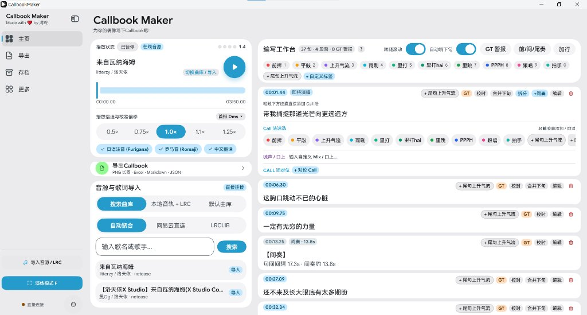
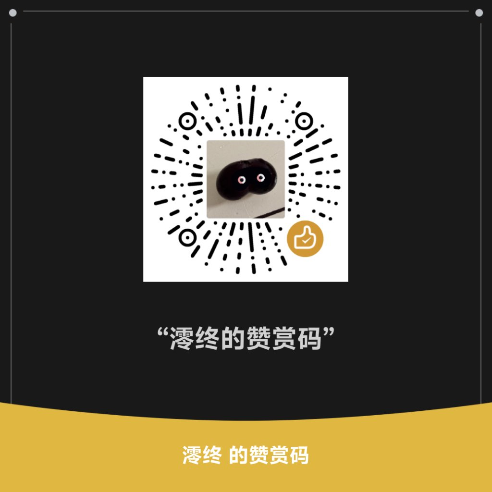

# CallbookMaker



一个面向 Live 应援、打 Call 爱好者与 CallLeader 的 Call 本制作工具，基于 Flutter 开发。

## 支持平台

目前支持 **Android** 与 **Windows**（不支持 Web、iOS、macOS 和 Linux）。

## 功能说明

- **音源与歌词导入**：支持导入本地音频与 LRC 文件，无需部署任何外部后端即可通过内置直连引擎检索网易云音乐或 LRCLIB 歌曲与歌词；可在「更多 -> 网关配置」中按需粘贴网易云 `MUSIC_U` Cookie 登录账号。
- **时间轴编辑与打标**：内置常用 Call 法预设，支持自定义标签、对位 Call（含对位罗马音）、mix/口上备注、GT 警报、前/间/尾奏自动识别与手动调整，以及歌词拆分、合并、校时（目前有偶发 bug）和撤销。
- **离线日语注音与罗马音词典**：内置完整日语形态素词典（IPADIC / `kuromoji_dart`），搜歌或导入 LRC 时**纯离线自动生成**汉字假名注音（Ruby / Furigana）与平文式罗马音（自动跳过纯中文歌词）；支持按需优先采用网易云自带罗马音（`romalrc`）并用内置词典补全缺失行，同时支持假名、罗马音和中文翻译分层开关与导出。
- **~~节拍器~~与演练模式**：支持倍速播放与全屏跟拍演练（~~内置低延迟节拍器与首拍偏移校准~~，目前测试存在 bug，暂划掉待修复）。
- **多格式导出**：支持导出 PNG 长图、双工作表 Excel（`.xlsx`）、Markdown 文本与 JSON 工程文件，可填写作曲、作词、编曲、混音、演唱、调教、应援色以及编者信息。
- **外观与存档管理**：支持深浅主题切换、应援色预设、HCT 调色盘及自定义十六进制应援色输入，支持本地多工程存档切换。

## 下载与使用

前往本仓库的 [Releases](https://github.com/lingzhong-dev/CallbookMaker-app/releases) 页面下载对应平台的安装包：

- **Windows**：下载安装程序（`setup.exe`）或便携压缩包，主程序为 `CallbookMaker.exe`。
- **Android**：下载对应架构或通用版 `.apk` 安装使用。

## 从源码构建

需要本地安装 Flutter SDK（Dart >= 3.10.0）及对应平台的编译工具链。

```bash
flutter pub get

# 运行测试
flutter test

# 构建 Windows 发布版
flutter build windows --release

# 构建 Android APK
flutter build apk --release
```

## 已知问题与反馈

上述划掉及标明存在 bug 的功能计划于下周末（2026.11.27 - 11.29）集中修复。如果在使用过程中遇到其他问题，欢迎提交 [GitHub Issue](https://github.com/lingzhong-dev/CallbookMaker-app/issues) 或发邮件至 [lingzhongmiao@gmail.com](mailto:lingzhongmiao@gmail.com)。

## 致谢

- UI 设计参考与灵感来自 [FlClash](https://github.com/chen08209/FlClash)，非常感谢该项目在界面与交互上的优秀实现。
- 感谢以下朋友在开发过程中的协助测试与反馈：
  - 洛雪绫波
  - 空想主义者
  - 俗书
  - PriorityLeft
  - cmy

## 支持作者

如果你觉得我做得不错、整了个好活，欢迎给本仓库点一个 [Star](https://github.com/lingzhong-dev/CallbookMaker-app)，也可以通过下方的微信赞赏码捐赠支持一下，万分感谢。



> それぞれが好きなことで頑張れるなら  
> 如果每个人都能为自己的所爱付诸努力  
> 新しい（場所が）ゴールだね  
> 终点就会是全新的舞台  
> 　　　　　　　　　　　——《僕らは今のなかで 》 (我们活在当下)-μ's（Muse）

## 开源协议

本项目基于 [GNU General Public License v3.0](./LICENSE) 开源。

---

Made with ❤ by 澪终
